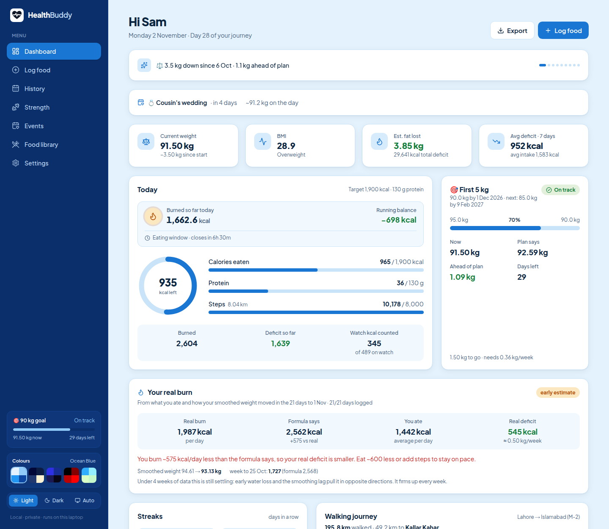
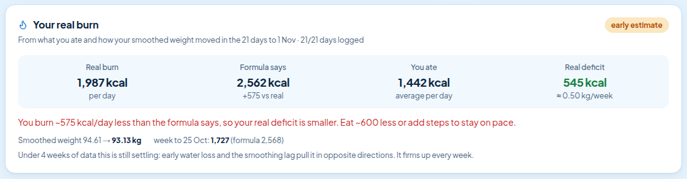
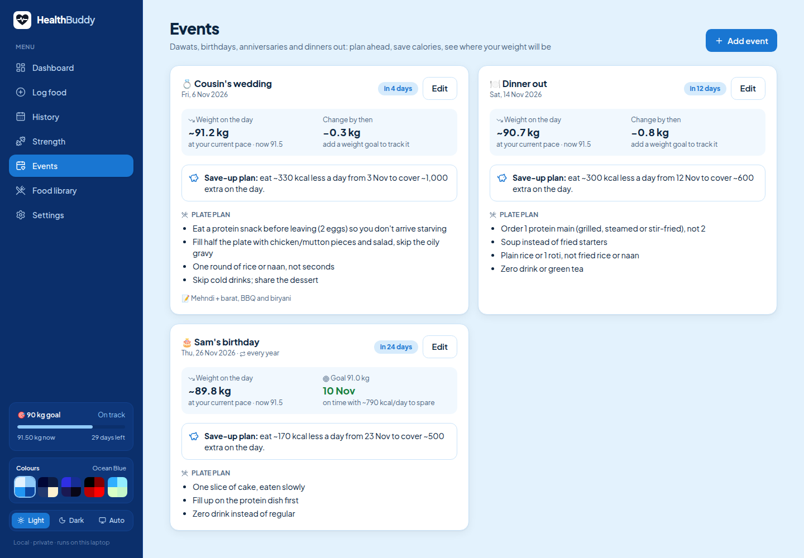
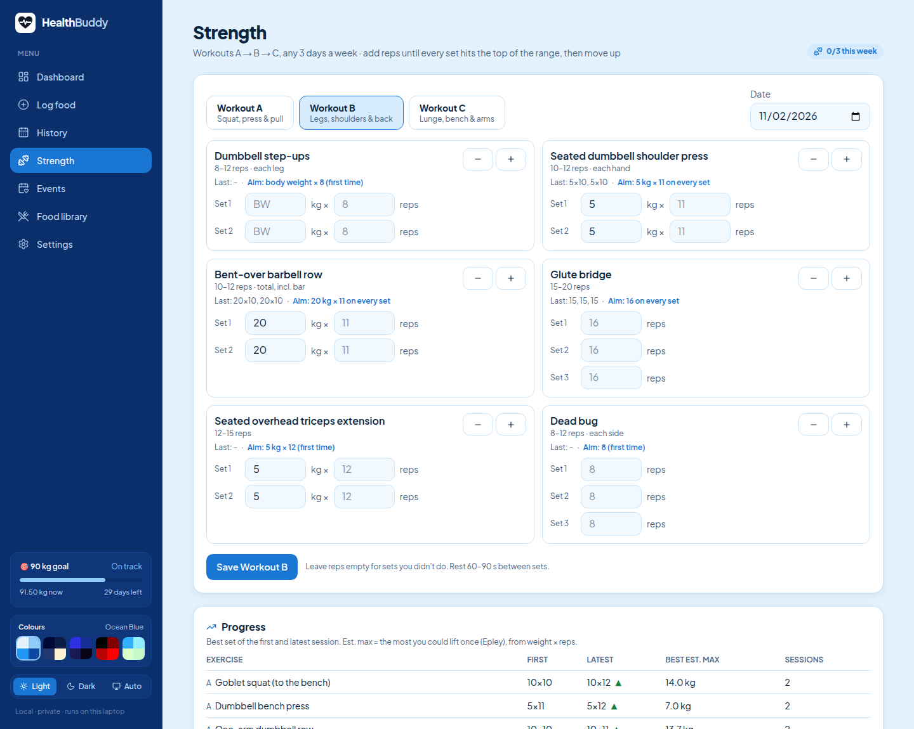
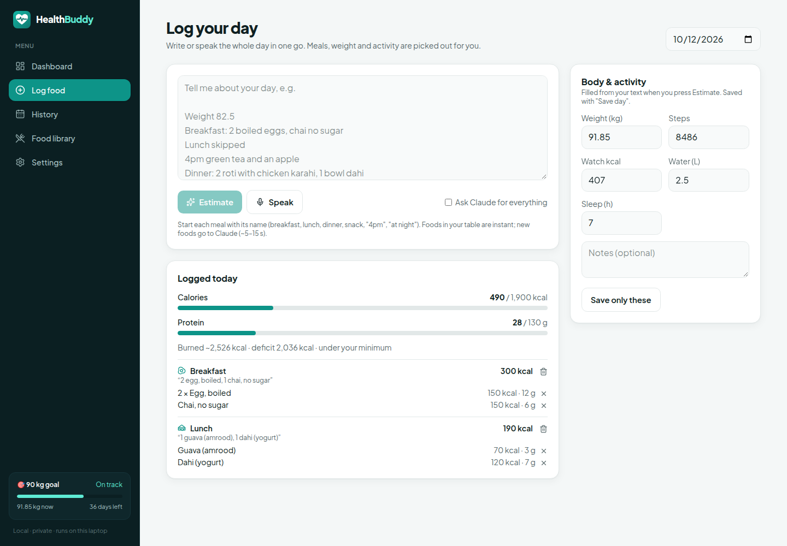
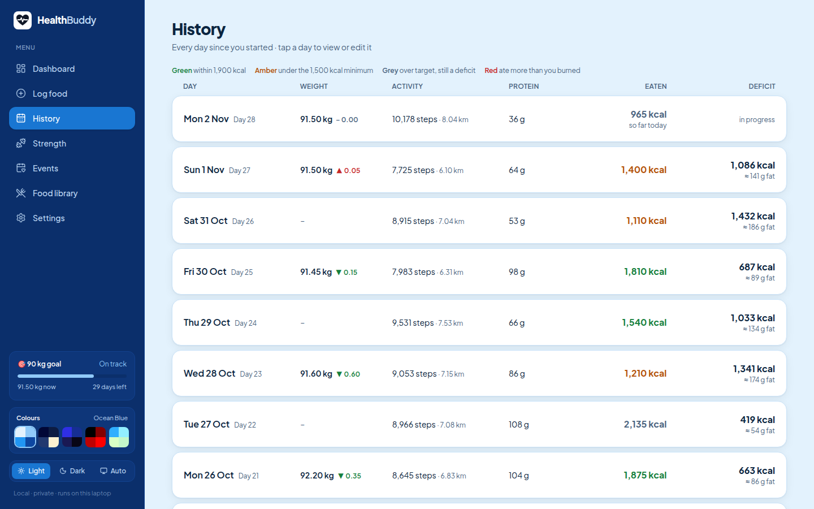
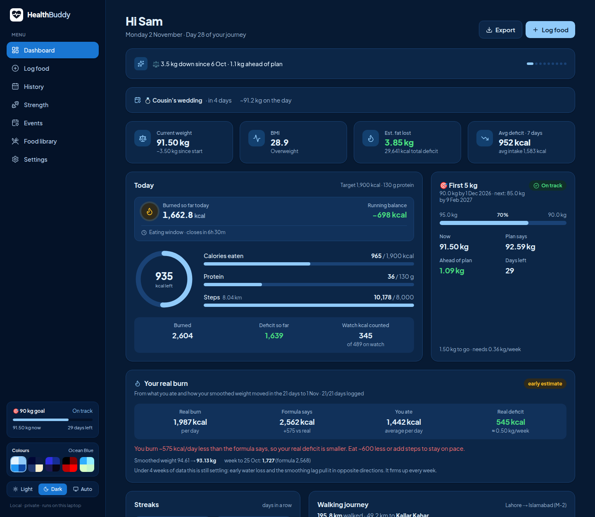
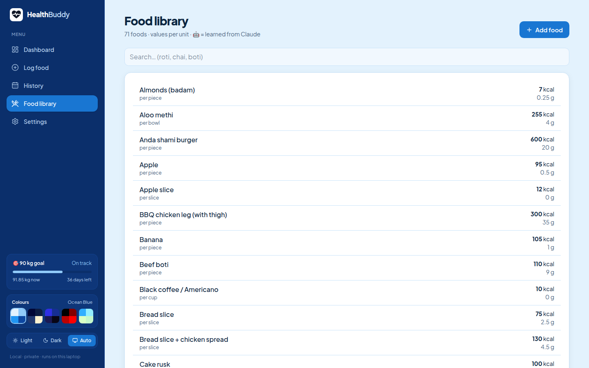
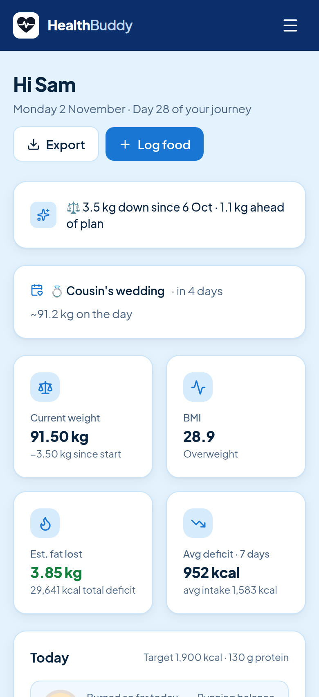
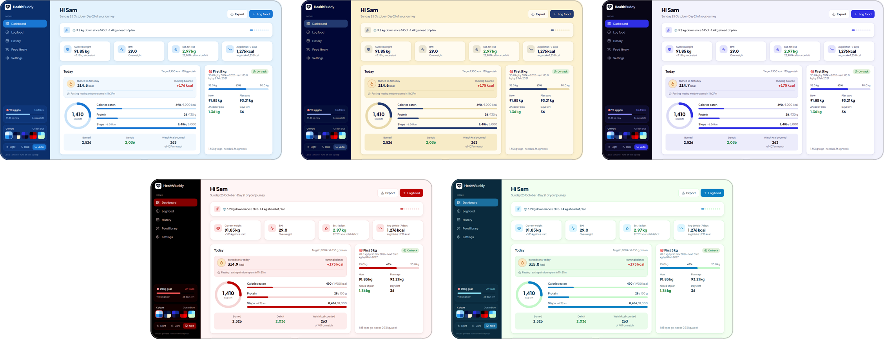

<div align="center">
  
  <h1>Health Buddy</h1>
  <p><b>A private, local-first calorie and weight-loss tracker.</b><br/>
  Speak or type your whole day in one go. Meals, weight and activity are picked out for you.</p>
</div>



> Screenshots use a generated demo profile (`npm run demo`). No real person's data is shown.

## Why

Most calorie apps want you to search a barcode database for every bite, and they don't know what
*"2 roti, aloo gosht 1 bowl, chai bina cheeni"* means. Health Buddy lets you log the way you'd text a friend,
runs on your own machine, and keeps your data in a single SQLite file you own.

## Features

### Logging
- **The whole day in one message.** Write or say *"Weight 82.5. Breakfast 2 boiled eggs and chai. Lunch skipped.
  Dinner 2 roti with chicken karahi. 7k steps, 5.2 km, 350 kcal from watch, slept 7 hours"*. It splits the text into
  meals and pulls out weight, steps, distance, watch calories, water and sleep. Check one preview, press **Save day**.
- **Instant estimates from your own food table.** 70+ South Asian home foods to start with (roti, daal, salan, pulao,
  chai…). Matching understands quantities and Roman Urdu (*do roti*, *aadha plate*, *4-5 spoons*).
- **Claude for anything new, without an API key.** Unknown foods go to the
  [Claude Code CLI](https://docs.claude.com/en/docs/claude-code) in headless mode (`claude -p`), using your
  existing Claude login. Each answer is saved to the food table, so it's instant next time.
- **Local speech-to-text.** The 🎤 button records in the browser and transcribes with
  [whisper.cpp](https://github.com/ggml-org/whisper.cpp) on your machine. Audio never leaves it.

### Dashboard
- **Live "burned so far" counter.** Calories burned since midnight tick up every second, with a running balance
  against what you've eaten.
- **Eating-window clock.** Shows *fasting · window opens in 2h* or *window closes in 3h*. Set the window in Settings.
- **Rotating insights.** A strip that cycles through your progress: kilos lost, how far ahead of plan you are, when
  the plan reaches your next whole kilo, best day, protein average, and fun comparisons for your total deficit.
- **Streaks.** Days in a row in a deficit, within your calorie target, at your protein target, and at your step
  target, each with your best run.
- **Walking journey.** Your total distance drawn as a dot travelling along a route with stops (a road trip
  between two cities by default, which you can edit), animated on load.
- **Up to three milestones.** Weights to reach by a date on the way to your final goal, added, edited and removed
  in Settings. The dashboard follows the earliest one until its date passes, then moves to the next; the plan line
  continues from one to the other, with an on-track / behind status and the weekly pace you need.
- **Body progress.** Three figures drawn from your BMI (where you started, where you are now and your goal) side by
  side, plus a BMI ladder and an estimated body-fat % (from BMI and age only).
- **Charts and weekly summary.** Weight vs plan, calories in vs out, protein, steps and distance. The weekly table
  groups *daily averages* and *week totals* and shows the change from the week before.
- **Next event strip.** Your next dawat or birthday within a month, with your forecast weight and today's save-up.
- **Today is "in progress".** A half-logged day never counts as a full day's deficit: totals, averages, streaks
  and fat lost only include finished days.
- **Choose your sections.** Switch any part of the dashboard off in Settings; the rest closes the gap. Pages you
  don't use (History, Strength, Events, Ramadan, Food library) can be hidden from the sidebar the same way.

### Your real burn
Formulas guess what you burn. Health Buddy also **measures** it: it compares what you ate with how your smoothed
weight actually moved over the last 3 weeks and works backwards to your real daily burn (the approach adaptive apps
like MacroFactor use), right next to the formula's number.

- **Formula close?** Your deficits are real.
- **Real burn lower?** It tells you how much less to eat (or how many more steps) to stay on pace.
- **Real burn higher?** Usually water loss early on, or food counted on the high side.
- Weigh-ins are smoothed first, so a salty dinner doesn't throw it off. It needs most days logged and shows the
  estimate for earlier weeks, so you can watch your burn fall as you get lighter.



### Events
Plan around the meals you can't skip: dawats, weddings, dinners out, birthdays, anniversaries.

- **Weight on the day:** where your trend puts you on that date.
- **Weight goal (optional):** the date you'll reach it at your current pace, and how many kcal a day you're short or
  have to spare.
- **Save-up plan:** enter the extra kcal you expect and it spreads them over the days before
  (e.g. 1,000 over 3 days = ~330 less a day).
- **Plate plan:** tips for that kind of meal, such as protein first, one round of rice, zero drinks.
- **Yearly events repeat**, past one-offs link to the log for that day, and the next event shows on the dashboard.



### Strength
Three full-body home workouts (A → B → C, any 3 days a week), logged set by set.

- Each exercise shows **what you did last time** and **what to aim for**: add reps until every set reaches the top of
  the range, then move up a weight, using the dumbbells and plates you actually own (5/10/15 kg dumbbells, +10 kg
  on the bar).
- Light weeks first (2 sets for the first 6 sessions, then 3), a this-week counter, and a **progress table** with each
  lift's estimated one-rep max.
- Edit the exercises in `src/lib/workouts.ts`.



### Ramadan
A month of fasting changes everything about the day, so it gets its own mode.

- **Sehri and iftar times** for every fast, worked out on your machine from your location (Fajr and Isha at 18°,
  Karachi method; default Lahore, set yours in Settings). No internet or prayer-times service needed.
- **On fasting days the eating-window clock switches to iftar → sehri** and the dashboard shows the day's times.
- **A calorie split** for iftar (40%), after Taraweeh (15%) and sehri (45%), with protein per meal and tips:
  dates and water first, eggs and yogurt at sehri, walk after Taraweeh, 8 glasses between iftar and sehri.
- **Post-Eid guard:** most Ramadan weight loss comes back within a few weeks, so for 28 days after Eid the dashboard
  compares your weight with your Eid weight.
- Set the first and last fast in Settings once the moon is sighted.

### History
- One row per day with weight change (▼ / ▲), steps and km, protein, calories eaten and the day's deficit with its
  fat equivalent.
- Colour-coded: **green** within target, **amber** under your minimum, **grey** over target but still a deficit,
  **red** if you ate more than you burned. Today is marked *in progress* and isn't counted in totals until it's over.

### Look and feel
- **Five colour palettes** (Ocean Blue, Navy & Cream, Electric Indigo, Crimson Black, Sky & Mint), each with a light
  and a dark version, plus Light / Dark / Auto. Pick them in the sidebar.
- Chart colours for every palette are checked to be colour-blind safe. Status colours stay the same in all of them.
- Works on a phone-sized screen, and animations turn off when your system asks for reduced motion.

### Honest maths
- Mifflin-St Jeor BMR × activity factor, plus only the watch calories for steps *above* your everyday baseline
  (so normal movement isn't counted twice). 7,700 kcal ≈ 1 kg of fat.
- Distance uses your band's km when you log it, otherwise steps × your step length (set in Settings).
- CSV export of every day.

| Log your day | History |
|---|---|
|  |  |

| Dark mode | Food library | Mobile |
|---|---|---|
|  |  |  |

**Palettes**



## How it works

```
 🎤 voice ──whisper.cpp (local)──▶ text
 ⌨️ text ───────────────────────▶ split into stats + meals  (src/lib/dayparse.ts)
                                        │
                              food table match              (src/lib/parse.ts)
                                        │ unknown foods only
                                        ▼
                              claude -p --json-schema       (src/lib/claude.ts)
                                        │
                              editable preview ──▶ SQLite   (data/health.db)
```

Dashboard extras (streaks, insights, journey route) live in `src/lib/insights.ts`, real burn in `src/lib/tdee.ts`,
event planning in `src/lib/events.ts`, the workouts and progression rules in `src/lib/workouts.ts`, and prayer times
and Ramadan mode in `src/lib/prayer.ts` and `src/lib/ramadan.ts`. Palettes are CSS variables in
`src/app/globals.css`, switched with `<html data-palette>`.

## Logging from scripts (or an AI coach)

Everything the app does goes through a small JSON API on `127.0.0.1:4782`, so you can log from a script, a shortcut,
or a chat assistant that knows your day. A few useful calls:

```bash
# a whole day (or part of one): meals + weight/steps; send only what you have
curl -X POST http://127.0.0.1:4782/api/day-log -H 'content-type: application/json' -d '{
  "date": "2026-11-02",
  "entries": [{ "meal": "breakfast", "raw_text": "2 boiled eggs, chai",
                "items": [{ "name": "Egg, boiled", "qty": 2, "unit": "piece", "kcal": 150, "protein": 12 }] }],
  "stats": { "weight": 82.4, "steps": 9200, "distance_km": 7.1, "active_kcal": 480 }
}'

# a workout session (replaces that date + workout)
curl -X POST http://127.0.0.1:4782/api/workouts -H 'content-type: application/json' -d '{
  "date": "2026-11-02", "workout": "A",
  "sets": [{ "exercise": "Goblet squat (to the bench)", "set_no": 1, "weight": 10, "reps": 12 }]
}'

# an event
curl -X POST http://127.0.0.1:4782/api/events -H 'content-type: application/json' -d '{
  "name": "Ali'"'"'s wedding", "date": "2026-12-12", "kind": "wedding", "extra_kcal": 1000, "bank_days": 3
}'
```

Meals are `breakfast`, `lunch`, `snack`, `dinner` or `drink`. Dates can't be in the future (events can), numbers are
range-checked, and a bad request gets a `400` with the reason. Other routes: `GET /api/export` (CSV),
`PUT /api/days/:date`, `PUT /api/profile`, `/api/foods`, `/api/entries/:id`, `/api/items/:id`.

## Getting started

**Requirements:** Node 20+. For the optional features: the Claude Code CLI (logged in), and a C/C++ toolchain + CMake
for whisper.cpp.

```bash
git clone https://github.com/<you>/health-buddy.git
cd health-buddy
npm install
npm run build && npm start          # http://127.0.0.1:4782
```

Open **Settings** first and enter your height, weight, targets, step length, eating window and (optionally) your
milestones. Everything works without Claude or Whisper; you can always type the numbers yourself.

Want to look around first? `npm run demo`, then `HEALTH_DB=data/demo.db npm start` runs the app with a made-up user.

<details>
<summary><b>Claude estimates (optional)</b></summary>

```bash
curl -fsSL https://claude.ai/install.sh | bash
claude        # log in once, then /exit
```

The app looks for the CLI at `~/.local/bin/claude` (override with `CLAUDE_BIN`). Calls run with no tools, no settings
and no session history (`--tools "" --setting-sources "" --no-session-persistence`), and count against your normal
Claude usage. Use **Settings → About your food** to tell Claude about your cuisine, cooking oil or usual recipes.
</details>

<details>
<summary><b>Voice input with whisper.cpp (optional)</b></summary>

```bash
git clone --depth 1 https://github.com/ggml-org/whisper.cpp.git whisper
cd whisper && cmake -B build -DCMAKE_BUILD_TYPE=Release && cmake --build build -j --target whisper-cli
bash models/download-ggml-model.sh small        # ~466 MB, multilingual
```

Browsers only allow the microphone on `localhost` or HTTPS. The `small` model transcribes a short sentence in a few
seconds on a laptop CPU. Override paths with `WHISPER_DIR` / `WHISPER_MODEL`.
</details>

<details>
<summary><b>Run it in the background (Linux, systemd)</b></summary>

```ini
# ~/.config/systemd/user/health-buddy.service
[Unit]
Description=Health Buddy

[Service]
WorkingDirectory=/path/to/health-buddy
ExecStart=/usr/bin/npm start
Restart=on-failure

[Install]
WantedBy=default.target
```

```bash
systemctl --user enable --now health-buddy
```
</details>

## Scripts

| Command | What it does |
|---|---|
| `npm run dev` | Dev server with hot reload (http://127.0.0.1:4782) |
| `npm run build` / `npm start` | Production build / server |
| `npm run typecheck` | TypeScript check |
| `npm run demo` | Build a demo database (4 weeks, events, workouts) for a made-up user, then `HEALTH_DB=data/demo.db npm start` |
| `node scripts/backup-db.mjs [out.db]` | Safe snapshot of the live database |
| `npm run import:csv [file]` | Import a daily CSV log (see `scripts/import-csv.mjs` for the columns) |

## Privacy

- Your data lives in `data/health.db` on your machine (or wherever `HEALTH_DB` points). `data/` is git-ignored, so
  back it up yourself.
- Voice is transcribed locally. The only things that leave your machine are the food lines the table doesn't know and
  your "About your food" note, sent to Claude through your own CLI login.
- The API refuses writes from other websites (checked by Origin in `src/proxy.ts`), so a page open in your browser
  can't add entries or run Claude on your account. Scripts and `curl` on your machine still work.
- Palette and theme choices are kept in your browser's local storage.
- The server binds to `127.0.0.1` by default. To use it from a phone on your Wi-Fi, bind to `0.0.0.0` and set
  `allowedDevOrigins` in `next.config.ts`, and note that browsers block the microphone on plain `http`.

## Tech

Next.js 16 (App Router, Cache Components) · React 19 · TypeScript · Tailwind CSS 4 · Recharts 3 · better-sqlite3 ·
lucide-react · whisper.cpp · Claude Code CLI.

## Disclaimer

Calorie numbers are estimates. This is a personal tracking tool, not medical advice. Talk to a doctor before big
changes to your diet or exercise.

## License

[MIT](LICENSE) © 2026 Ahmad Mujahid
