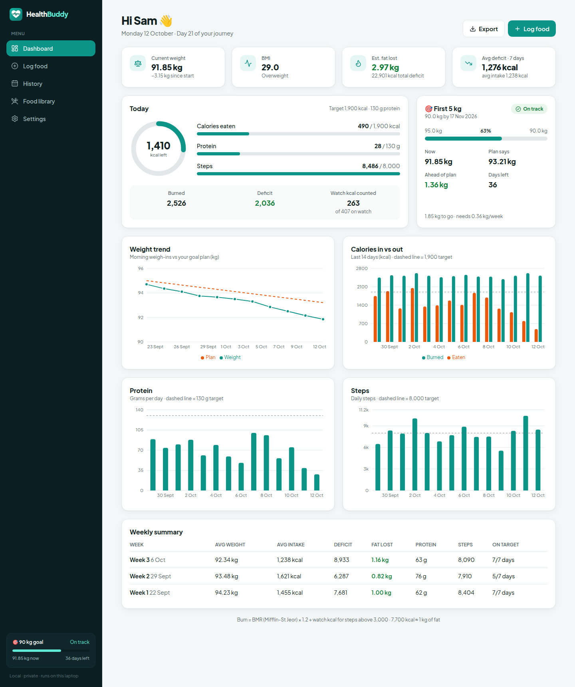
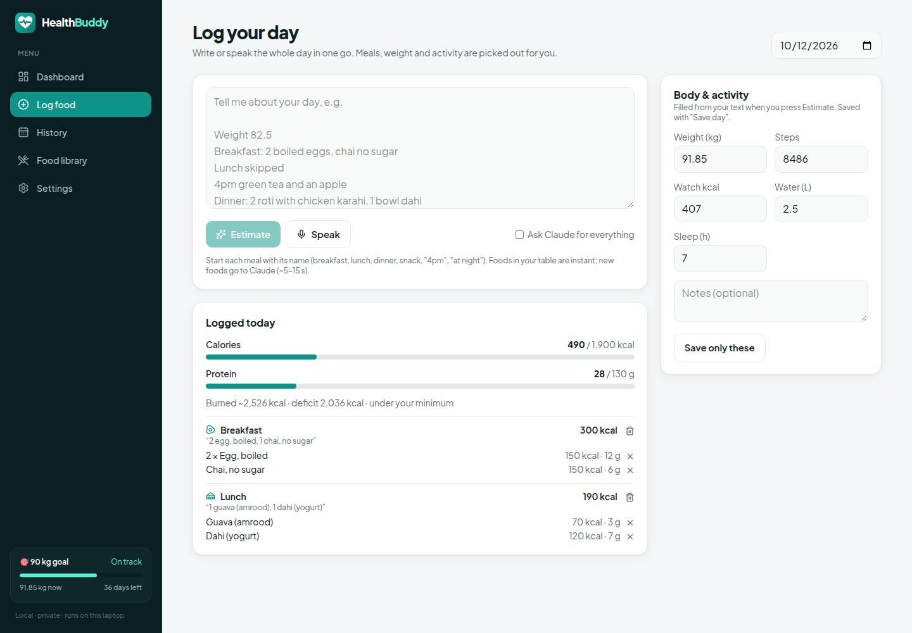
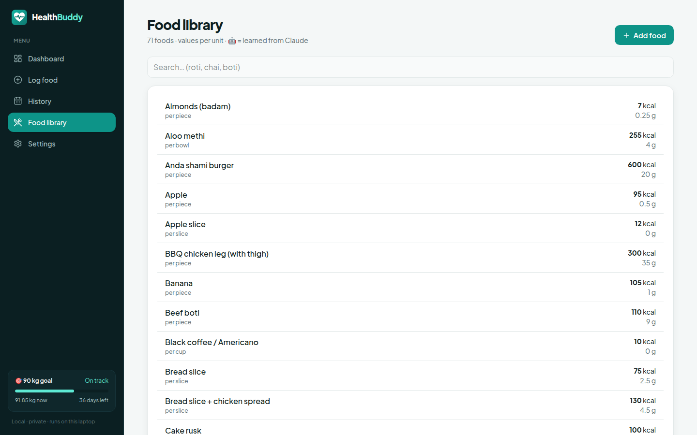
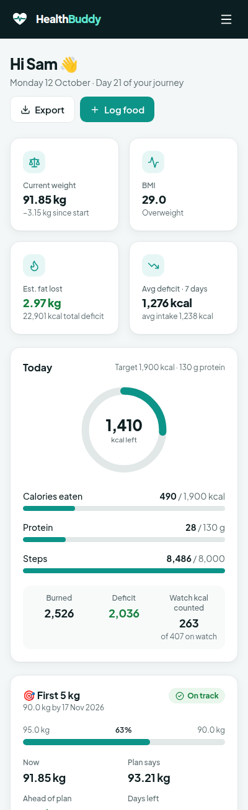
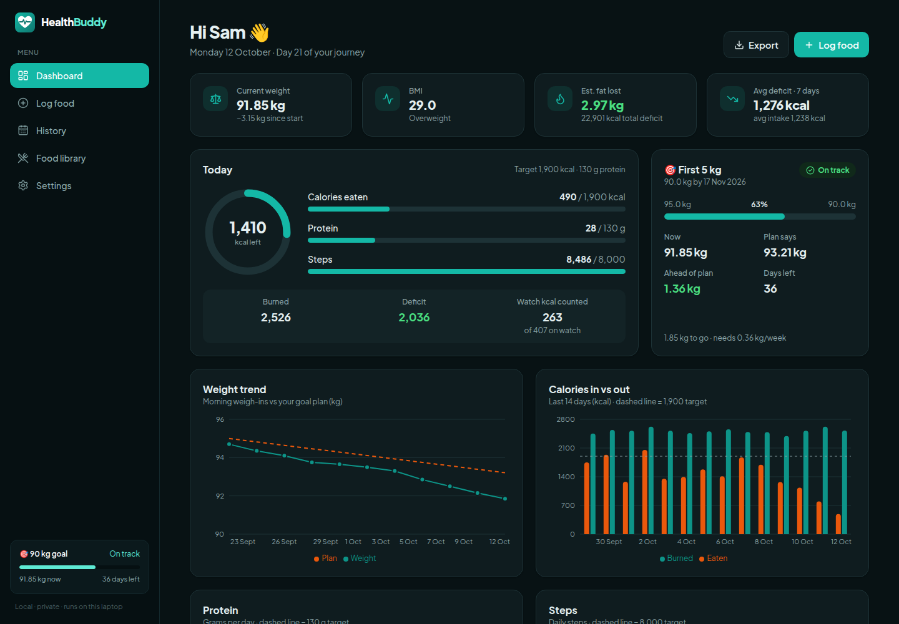

<div align="center">
  
  <h1>Health Buddy</h1>
  <p><b>A private, local-first calorie and weight-loss tracker.</b><br/>
  Speak or type your whole day in one go — meals, weight and activity are picked out for you.</p>
</div>



> Screenshots use a generated demo profile (`npm run demo`). No real person's data is shown.

## Why

Most calorie apps want you to search a barcode database for every bite, and they don't know what
*"2 roti, aloo gosht 1 bowl, chai bina cheeni"* means. Health Buddy lets you log the way you'd text a friend,
runs on your own machine, and keeps your data in a single SQLite file you own.

## Features

- **Log the whole day in one message.** Write (or say) *"Weight 82.5. Breakfast 2 boiled eggs and chai. Lunch skipped.
  Dinner 2 roti with chicken karahi. 7k steps, 350 kcal from watch, slept 7 hours"* — it splits it into meals and
  pulls out weight, steps, watch calories, water and sleep. Review one preview, press **Save day**.
- **Instant estimates from your own food table.** 70+ South Asian home foods to start (roti, daal, salan, pulao,
  chai…). Matching understands quantities and Roman Urdu (*do roti*, *aadha plate*, *4-5 spoons*).
- **Claude for anything new — without an API key.** Unknown foods are sent to the
  [Claude Code CLI](https://docs.claude.com/en/docs/claude-code) in headless mode (`claude -p`), using your
  existing Claude login. Each answer is saved to the food table, so it's instant next time.
- **Local speech-to-text.** The 🎤 button records in the browser and transcribes with
  [whisper.cpp](https://github.com/ggml-org/whisper.cpp) on your machine. Audio never leaves it.
- **Honest maths.** Mifflin-St Jeor BMR × activity factor, plus only the watch calories for steps *above* your
  everyday baseline (so normal movement isn't counted twice). 7,700 kcal ≈ 1 kg of fat.
- **Dashboard.** Calorie ring, protein and step targets, a milestone goal with an on-track/behind status,
  weight vs plan, calories in vs out, weekly summary, CSV export. Light and dark mode.

| Log your day | Food library | Mobile | Dark |
|---|---|---|---|
|  |  |  |  |

## How it works

```
 🎤 voice ──whisper.cpp (local)──▶ text
 ⌨️ text ───────────────────────▶ split into stats + meals  (src/lib/dayparse.ts)
                                        │
                              food table match              (src/lib/parse.ts)
                                        │ unknown foods only
                                        ▼
                              claude -p --json-schema       (src/lib/claude.ts)
                                        │
                              editable preview ──▶ SQLite   (data/health.db)
```

## Getting started

**Requirements:** Node 20+, and for the optional features: the Claude Code CLI (logged in) and a C/C++ toolchain + CMake for whisper.cpp.

```bash
git clone https://github.com/<you>/health-buddy.git
cd health-buddy
npm install
npm run build && npm start          # http://localhost:4782
```

Open **Settings** first and enter your height, weight, targets and (optionally) a milestone goal. Everything works
without Claude or Whisper — you can always type the numbers yourself.

<details>
<summary><b>Claude estimates (optional)</b></summary>

```bash
curl -fsSL https://claude.ai/install.sh | bash
claude        # log in once, then /exit
```

The app looks for the CLI at `~/.local/bin/claude` (override with `CLAUDE_BIN`). Calls run with no tools, no settings
and no session history (`--tools "" --setting-sources "" --no-session-persistence`), and count against your normal
Claude usage. Use **Settings → About your food** to tell Claude about your cuisine, cooking oil or usual recipes.
</details>

<details>
<summary><b>Voice input with whisper.cpp (optional)</b></summary>

```bash
git clone --depth 1 https://github.com/ggml-org/whisper.cpp.git whisper
cd whisper && cmake -B build -DCMAKE_BUILD_TYPE=Release && cmake --build build -j --target whisper-cli
bash models/download-ggml-model.sh small        # ~466 MB, multilingual
```

Browsers only allow the microphone on `localhost` or HTTPS. The `small` model transcribes a short sentence in a few
seconds on a laptop CPU. Override paths with `WHISPER_DIR` / `WHISPER_MODEL`.
</details>

<details>
<summary><b>Run it in the background (Linux, systemd)</b></summary>

```ini
# ~/.config/systemd/user/health-buddy.service
[Unit]
Description=Health Buddy

[Service]
WorkingDirectory=/path/to/health-buddy
ExecStart=/usr/bin/npm start
Restart=on-failure

[Install]
WantedBy=default.target
```

```bash
systemctl --user enable --now health-buddy
```
</details>

## Scripts

| Command | What it does |
|---|---|
| `npm run dev` | Dev server with hot reload (http://localhost:4782) |
| `npm run build` / `npm start` | Production build / server |
| `npm run typecheck` | TypeScript check |
| `npm run demo` | Build a demo database with a made-up user, then `HEALTH_DB=data/demo.db npm start` |
| `node scripts/backup-db.mjs [out.db]` | Safe snapshot of the live database |
| `npm run import:csv [file]` | Import a daily CSV log (see `scripts/import-csv.mjs` for the columns) |

## Privacy

- Your data lives in `data/health.db` on your machine. `data/` is git-ignored — back it up yourself.
- Voice is transcribed locally. The only thing that leaves your machine is the text of a food line the table doesn't
  know, sent to Claude through your own CLI login.
- The server binds to `127.0.0.1` by default. To use it from a phone on your Wi-Fi, bind to `0.0.0.0` and set
  `allowedDevOrigins` in `next.config.ts` — and note that browsers block the microphone on plain `http`.

## Tech

Next.js 16 (App Router, Cache Components) · React 19 · TypeScript · Tailwind CSS 4 · Recharts 3 · better-sqlite3 ·
lucide-react · whisper.cpp · Claude Code CLI.

## Disclaimer

Calorie numbers are estimates. This is a personal tracking tool, not medical advice — talk to a doctor before big
changes to your diet or exercise.
